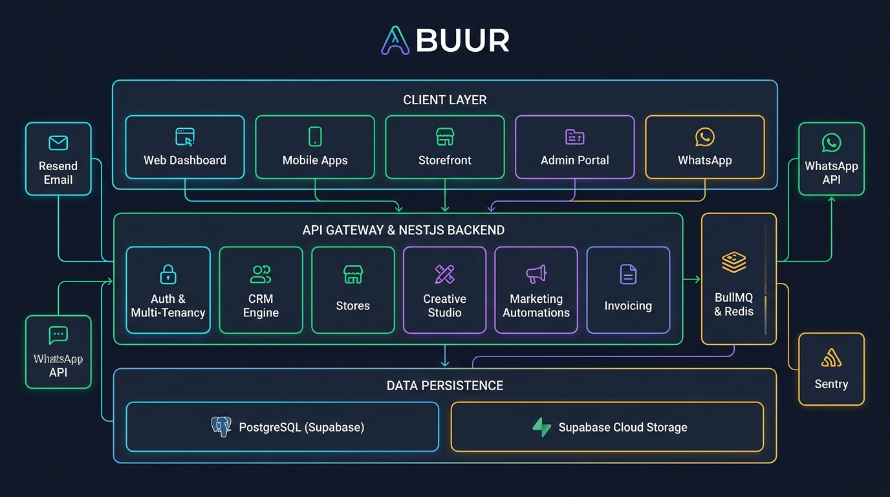

# ABUUR — Full Platform Architecture

> **Multi-Tenant Business Management Cloud**  
> NestJS v12 (ESM) • PostgreSQL (Supabase) • Prisma ORM v6 • BullMQ & Redis • Supabase Storage & Auth

---

## 1. Visual Architecture Diagrams

### High-Resolution Rendered Schematic

### Scalable Vector Graphic (SVG)
You can view the interactive, zoomable vector version directly in [platform-architecture.html](./platform-architecture.html) or download [platform-architecture.svg](./platform-architecture.svg).

---

## 2. Interactive Mermaid Architecture Blueprint

```mermaid
flowchart TD
  %% Clients & Ingestion
  subgraph CLIENTS ["1. Client & Ingestion Layer"]
    C1["👤 Admin Backoffice<br/>(Operations, Tiers, Audit Logs)"]
    C2["🏢 Business Owner Dashboard<br/>(CRM, Studio, Campaigns, Invoices)"]
    C3["🛍️ Storefront & Buyers<br/>(Custom Domains, Catalog, Orders)"]
    C4["💬 WhatsApp Bot & Callbacks<br/>(Conversational Commerce & Webhooks)"]
  end

  %% Edge & Security
  subgraph GATEWAY ["2. Edge, Network & Security Pipeline"]
    GW1["Global Middleware<br/>Helmet • CORS • Gzip Compression"]
    GW2["ValidationPipe<br/>class-validator • class-transformer"]
    GW3["Authentication & RBAC<br/>JwtAuthGuard • RolesGuard (OWNER..VIEWER)"]
    GW4["Multi-Tenant Scope Guard<br/>businessId isolation & standalone stores"]
    GW5["Webhook Ingestion Engine<br/>HMAC Signature • Idempotency Hash"]
  end

  %% Application Core
  subgraph NESTJS ["3. NestJS Application Core (src/app.module.ts)"]
    subgraph MOD_CORE ["Identity & Core Platform"]
      M_USER["UserModule<br/>(Supabase Auth Bridge)"]
      M_BIZ["BusinessModule<br/>(Tenants)"]
      M_MEM["BusinessMembershipModule<br/>(Roles & Status)"]
      M_PLAN["Plan & SubscriptionModule<br/>(Billing & Trials)"]
      M_AUDIT["AuditLogModule<br/>(Immutable Action Log)"]
    end

    subgraph MOD_CRM ["CRM & Leads"]
      M_CRM["CRMCustomerModule<br/>(Customer 360)"]
      M_LEAD["LeadModule<br/>(Sales Pipeline & Stages)"]
    end

    subgraph MOD_STUDIO ["Creative Production Studio"]
      M_CREQ["CreativeRequestModule<br/>(Intake Briefs)"]
      M_CPRJ["CreativeProjectModule<br/>(Project Workspaces)"]
      M_CTSK["CreativeTaskModule<br/>(Kanban Tasks)"]
      M_CREV["CreativeReviewModule<br/>(Client Approvals)"]
    end

    subgraph MOD_MKT ["Omnichannel Marketing Engine"]
      M_MCON["MarketingContactModule<br/>(Opt-in: WA / SMS / Email)"]
      M_CAMP["CampaignModule<br/>(Broadcast Scheduling)"]
      M_CREC["CampaignRecipientModule<br/>(Delivery State Tracking)"]
    end

    subgraph MOD_STORE ["Commerce & Store Engine"]
      M_STR["Store & StoreDomainModule<br/>(Integrated & Standalone)"]
      M_CAT["Product & CategoryModule<br/>(Catalog, Variants, SKUs)"]
      M_INV["InventoryMovementModule<br/>(Stock Adjustments)"]
      M_ORD["StoreCustomer & StoreOrderModule<br/>(Order State Machine)"]
      M_ITEM["StoreOrderItemModule"]
    end

    subgraph MOD_FIN ["Finance & Ledgers"]
      M_FIN["FinanceTransactionModule<br/>(Income & Expense)"]
      M_INVCE["Invoice & InvoiceItemModule<br/>(B2B Invoices)"]
      M_PAY["PaymentModule<br/>(Receipts & Reconciliation)"]
    end

    subgraph MOD_CROSS ["Cross-Cutting Services"]
      M_NOTIF["NotificationModule<br/>(In-App Real-time)"]
      M_FILE["FileAssetModule<br/>(Metadata Registry)"]
      M_INT["IntegrationConnectionModule<br/>(OAuth & Credentials)"]
    end
  end

  %% Async Queues
  subgraph ASYNC ["4. Asynchronous Processing & Queues"]
    REDIS[("Redis Broker<br/>ioredis")]
    Q_EMAIL["Email Queue<br/>BullMQ Processor"]
    Q_WA["WhatsApp Queue<br/>Rate-limited Processor"]
    Q_SMS["SMS Queue<br/>Telephony Dispatcher"]
    Q_HOOK["Webhook & Sync Queue<br/>Retry & DLQ"]
  end

  %% Persistence & Cloud
  subgraph PERSISTENCE ["5. Data Persistence & Storage"]
    PRISMA["Prisma ORM Service (v6)<br/>Typed Connection Pooling"]
    PG[("PostgreSQL Database (Supabase)<br/>UUID Keys • Relations • Indexes")]
    STORAGE[("Supabase Storage<br/>S3-Compatible Object Store")]
  end

  %% External Services
  subgraph EXTERNAL ["6. External Cloud & SaaS Providers"]
    EXT_AUTH["Supabase Auth<br/>(OAuth, Magic Links)"]
    EXT_RESEND["Resend API<br/>(Email Delivery)"]
    EXT_WA["WhatsApp Business API<br/>(Meta Cloud API)"]
    EXT_SMS["SMS Provider Gateway<br/>(Telephony DLR)"]
    EXT_SENTRY["Sentry + NestJS Observe<br/>(Telemetry & Error APM)"]
  end

  %% Flow Connections
  C1 & C2 & C3 --> GW1
  C4 --> GW5
  GW1 --> GW2 --> GW3 --> GW4

  GW4 --> MOD_CORE & MOD_CRM & MOD_STUDIO & MOD_MKT & MOD_STORE & MOD_FIN & MOD_CROSS
  GW5 --> M_INT

  MOD_CORE & MOD_CRM & MOD_STUDIO & MOD_MKT & MOD_STORE & MOD_FIN & MOD_CROSS --> PRISMA
  PRISMA --> PG

  M_MKT & M_STORE & M_NOTIF -.-> REDIS
  REDIS --> Q_EMAIL & Q_WA & Q_SMS & Q_HOOK

  Q_EMAIL --> EXT_RESEND
  Q_WA --> EXT_WA
  Q_SMS --> EXT_SMS
  EXT_WA & EXT_SMS -. Inbound Webhooks .-> GW5

  M_USER -. Token Validation .-> EXT_AUTH
  M_FILE --> STORAGE
  NESTJS -. Metrics & Traces .-> EXT_SENTRY
```

---

## 3. Tier-by-Tier Architectural Breakdown

### Tier 1: Client & Ingestion Layer
- **Platform Admin Backoffice**: Internal web console for platform super-administrators to manage tenant businesses, plan definitions, billing states, and audit trails.
- **Business Owner & Staff Dashboard**: Merchant-facing workspace providing full operational control over CRM, Creative Studio, marketing campaigns, product catalogs, and invoicing.
- **Storefront & Buyer Web Portal**: Multi-tenant public storefront supporting custom domains (`StoreDomainModule`), catalog search, cart operations, and customer checkout.
- **Conversational Commerce & Webhooks**: Inbound entry point for automated WhatsApp checkout interactions, delivery status reports, and provider event callbacks.

### Tier 2: Edge Gateway & Security Pipeline
Every incoming HTTP request executes through a strictly ordered pipeline:
1. **Global Middleware**: `helmet` applies CSP and security headers; `cors` enforces strict origin policies; `compression` optimizes response payloads.
2. **Global ValidationPipe**: Validates and transforms incoming payloads using `class-validator` and `class-transformer` against strongly-typed DTOs, stripping non-whitelisted attributes.
3. **JwtAuthGuard (`APP_GUARD`)**: Secures all routes by default with `passport-jwt`. Public endpoints are explicitly marked with `@Public()`.
4. **RolesGuard & Tenant Scope**: Enforces role hierarchy (`OWNER` > `ADMIN` > `MANAGER` > `EMPLOYEE` > `VIEWER`) and scopes queries by `businessId` to preserve multi-tenant boundary isolation.
5. **Webhook Ingestion Engine**: Verifies cryptographic signatures (HMAC) and records events in `WebhookEvent` with unique idempotency constraints before queuing for processing.

### Tier 3: NestJS Modular Application Core
Organized across cohesive domain modules in `src/app.module.ts`:
- **Identity & Organization Core**: `UserModule` (bridges external identity via `supabaseId`), `BusinessModule`, `BusinessMembershipModule`, `PlanModule`, `SubscriptionModule`, and `AuditLogModule`.
- **CRM & Sales Pipeline**: `CRMCustomerModule` (360-degree customer records) and `LeadModule` (sales opportunities and pipeline status transitions).
- **Creative Production Studio**: `CreativeRequestModule` (client intake forms), `CreativeProjectModule`, `CreativeTaskModule` (Kanban-style tasks), and `CreativeReviewModule` (approval cycles).
- **Omnichannel Marketing**: `MarketingContactModule` (opt-in contacts with channel consent flags), `CampaignModule` (broadcast schedules), and `CampaignRecipientModule` (per-recipient delivery tracking).
- **Commerce & Store Engine**: `StoreModule` (supporting both business-owned and standalone stores), `StoreDomainModule` (CNAME & SSL custom domains), `ProductModule`, `ProductCategoryModule`, `InventoryMovementModule`, `StoreOrderModule`, and `StoreOrderItemModule`.
- **Finance & Accounting**: `FinanceTransactionModule` (income/expense ledgers), `InvoiceModule`, `InvoiceItemModule`, and `PaymentModule` (invoice payment reconciliation).
- **Cross-Cutting Services**: `NotificationModule` (in-app alerts), `FileAssetModule` (asset metadata), and `IntegrationConnectionModule` (third-party credentials).

### Tier 4: Asynchronous Processing & BullMQ Queues
- **Redis Message Broker**: Central low-latency queue broker backing BullMQ state machines.
- **Dedicated Workers**:
  - `EmailProcessor`: Transactional emails and bulk campaign sending via Resend.
  - `WhatsAppProcessor`: Outbound WhatsApp Business API messaging with rate-limiting and burst controls.
  - `SMSProcessor`: Urgent alerts, OTPs, and SMS marketing.
  - `WebhookWorker`: Asynchronous retry handling with exponential backoff and Dead Letter Queue (DLQ) support.

### Tier 5: Persistence & Storage
- **PostgreSQL Database (Supabase)**: Relational source of truth structured via Prisma schema with UUID primary keys, cascade rules, and compound tenant indexes.
- **Supabase Storage**: S3-compatible cloud object store holding product images, creative deliverables, proof assets, and invoice PDFs. PostgreSQL stores the matching `FileAsset` metadata.

### Tier 6: External Integrations & Observability
- **Supabase Auth**: External identity provider for OAuth, password authentication, and session handling.
- **Resend**: Transactional email infrastructure with DKIM/SPF domain verification.
- **WhatsApp Cloud API**: Official Meta Cloud API for customer chat, template messaging, and order updates.
- **Sentry + NestJS Observe**: Distributed request tracing, performance monitoring, and production exception telemetry.

---

## 4. Multi-Tenancy & Data Isolation Model

| Entity Scope | Tenant Rule | Description |
|---|---|---|
| **Business-Owned Entities** | `businessId NOT NULL` | CRM, Leads, Campaigns, Creative Projects, Invoices, and Team Memberships are strictly partitioned by tenant ID. |
| **Store Scope** | `businessId NULLABLE` | Stores can operate within a Business organization or as an independent **Standalone Store**. |
| **User Identity** | Global `User` linked to `supabaseId` | Users can hold multiple memberships across different businesses with distinct role assignments. |
| **Audit Log** | Immutable log scoped by `businessId` & `userId` | Critical state modifications (status changes, payments, deletions) are logged with before/after state snapshots. |
