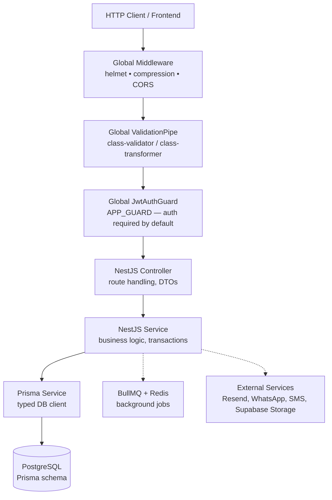

# ABUUR Backend Architecture

> Multi-tenant business management platform — NestJS + PostgreSQL + Prisma
>
> **Location:** `backend/`  
> **Framework:** NestJS v12 (TypeScript, ESM)  
> **Database:** PostgreSQL (via Prisma ORM v6)  
> **API:** REST + Swagger (OpenAPI)  
> **Auth:** JWT (passport-jwt) with Supabase user-id linking  
> **Jobs:** BullMQ + Redis  
> **Storage:** Supabase Storage (file bytes), PostgreSQL (metadata)

---

## 1. Overview

The ABUUR backend is a modular, multi-tenant business management platform. It supports:

- **Users & Businesses** — multi-tenant organisations with membership roles (OWNER, ADMIN, MANAGER, EMPLOYEE, VIEWER)
- **Subscriptions & Plans** — trial/active/past-due billing cycles, scoped to business or standalone store
- **CRM** — customers and leads
- **Creative Production** — requests, projects, tasks, reviews/approvals
- **Marketing** — contacts, campaigns (WhatsApp / SMS / Email), recipients
- **E-commerce / Stores** — integrated & standalone stores, products, categories, inventory, orders
- **Finance** — transactions, invoices, invoice items, payments
- **Notifications** — in-app, email (Resend), SMS, WhatsApp
- **Files** — metadata for assets stored in Supabase Storage
- **Integrations & Webhooks** — provider connections, idempotent webhook event processing
- **Audit Logs** — sensitive action tracking
- **Admin** — business, user, subscription, and audit-log administration

All business-owned records are scoped by `businessId` (application-level multi-tenancy). Standalone stores allow a nullable `businessId`.

---

## 2. System Context (Mermaid)

```mermaid
C4Context
  title System Context — ABUUR Backend

  Person(admin, "Admin / Staff", "Manages businesses, users, subscriptions")
  Person(owner, "Business Owner", "Runs a store, CRM, campaigns, orders")
  Person(customer, "End Customer", "Places orders via storefront / WhatsApp")

  System_Backend(backend, "ABUUR Backend (NestJS)", "REST API, auth, business logic, jobs")
  System_DB(db, "PostgreSQL (Supabase)", "Primary data store, Prisma ORM")
  System_Cache(redis, "Redis", "BullMQ job queues, caching")
  System_Auth(supabase_auth, "Supabase Auth", "External identity provider (user_id linked)")
  System_Storage(supabase_storage, "Supabase Storage", "File / media asset binaries")
  System_Email(resend, "Resend", "Transactional email delivery")
  System_WhatsApp(wa, "WhatsApp Business API", "Outbound WhatsApp messages")
  System_SMS(sms, "SMS Provider", "Outbound SMS delivery")
  System_Monitoring(sentry, "Sentry + NestJS Observe", "Error tracking, tracing, metrics")

  Rel(admin, backend, "REST API (JWT Bearer)")
  Rel(owner, backend, "REST API (JWT Bearer)")
  Rel(customer, backend, "REST API / Webhooks (storefront)")
  Rel(backend, db, "SQL (Prisma Client)", "PostgreSQL wire protocol")
  Rel(backend, redis, "BullMQ queues", "Redis protocol")
  Rel(backend, supabase_auth, "Validates user identity", "JWT / user lookup")
  Rel(backend, supabase_storage, "Upload / download files", "S3-compatible API")
  Rel(backend, resend, "Send email", "HTTP API")
  Rel(backend, wa, "Send WhatsApp messages", "HTTP API")
  Rel(backend, sms, "Send SMS", "HTTP API")
  Rel(backend, sentry, "Errors & traces", "HTTPS")
  Rel(wa, backend, "Inbound messages / status", "Webhook")
  Rel(sms, backend, "Delivery reports", "Webhook")
```

---

## 3. Layered Architecture (per module)



### Responsibility boundaries

| Layer | Responsibility |
|-------|----------------|
| **Controller** | HTTP routing, request/response DTOs, status codes, Swagger decorators |
| **Service** | Business logic, Prisma transactions, validation, external service calls |
| **Prisma Service** | Typed database access, connection management |
| **Queue / Processor** | Async jobs (email, WhatsApp, SMS), retries, dead-letter handling |
| **Guard** | Authentication (JWT) and authorization (roles, business scope) |
| **Interceptor / Filter / Pipe** | Cross-cutting concerns: transformation, exception handling, validation |

---

## 4. Technology Stack

| Layer | Technology | Version (from package.json) |
|-------|------------|-----------------------------|
| Runtime | Node.js | — |
| Language | TypeScript (ESM, `"type": "module"`) | ^6.0.2 (dev) |
| Framework | NestJS | ^12.0.1 |
| Config | `@nestjs/config` | ^12.0.1 |
| Database | PostgreSQL | — |
| ORM | Prisma | ^6.5.0 |
| Auth | JWT + passport-jwt | ^12.0.3 / ^4.0.1 |
| Password hashing | bcrypt (configured, 12 rounds) | — |
| Validation | class-validator / class-transformer | ^0.15.1 / ^0.5.1 |
| API Docs | Swagger (`@nestjs/swagger`, swagger-ui-express) | ^12.0.5 / ^5.0.1 |
| Background jobs | BullMQ + `@nestjs/bullmq`, ioredis | ^6.5.3 / ^6.0.0 |
| Email | Resend | ^6.37.0 |
| Observability | Sentry + NestJS Observe | ^11.10.0 / ^0.1.8 |
| Security | helmet, compression, CORS | ^8.3.0 / ^1.8.2 / ^2.8.6 |
| Testing | Jest + ts-jest (unit), Vitest (e2e) | ^30.5.2 / ^4.1.2 |
| Lint | oxlint | ^1.58.0 |
| Format | prettier | ^3.4.2 |
| Deployment | NestJS Mau (optional) | ^0.2.6 |

---

## 5. Module Inventory

All modules are registered in `src/app.module.ts`. Each follows `Module → Controller → Service (+ DTOs / repositories / interfaces / guards)`.

### Core / Infrastructure
| Module | Purpose |
|--------|---------|
| `PrismaModule` | PrismaClient singleton, DB connection |
| `Config` (`ConfigModule.forRoot`) | Global env config via `configuration.ts` |
| `AuthModule` | JWT auth, `JwtStrategy`, `JwtAuthGuard` (global), `RolesGuard` |
| `QueueModule` | BullMQ + Redis, global, email/WhatsApp/SMS processors |
| `EmailModule` | Email sending (Resend) |
| `WhatsAppModule` | WhatsApp Business API integration |
| `SMSModule` | SMS provider integration |
| `MonitoringModule` | Sentry / NestJS Observe telemetry |

### Business Domain
| Module | Purpose |
|--------|---------|
| `UserModule` | Users (linked to Supabase via `supabaseId`) |
| `BusinessModule` | Multi-tenant organisations |
| `BusinessMembershipModule` | User ↔ Business membership with roles & status |
| `PlanModule` | Subscription plans & pricing |
| `SubscriptionModule` | Business/store subscriptions, trials, billing |
| `CRMCustomerModule` | CRM customers |
| `LeadModule` | Sales leads |

### Creative Production
| Module | Purpose |
|--------|---------|
| `CreativeRequestModule` | Client creative requests |
| `CreativeProjectModule` | Projects created from requests |
| `CreativeTaskModule` | Tasks within projects (assignees, priority) |
| `CreativeReviewModule` | Review/approval cycles with feedback |

### Marketing
| Module | Purpose |
|--------|---------|
| `MarketingContactModule` | Contacts with consent flags (WhatsApp/SMS/Email) |
| `CampaignModule` | Campaigns (channel: WhatsApp/SMS/Email) |
| `CampaignRecipientModule` | Per-recipient delivery status & tracking |

### E-commerce / Stores
| Module | Purpose |
|--------|---------|
| `StoreModule` | Integrated & standalone stores |
| `StoreDomainModule` | Custom domains per store |
| `ProductCategoryModule` | Product categories |
| `ProductModule` | Products, SKUs, stock, status |
| `InventoryMovementModule` | Stock adjustments |
| `StoreCustomerModule` | Store customers |
| `StoreOrderModule` | Orders (status, payment status, WhatsApp handoff) |
| `StoreOrderItemModule` | Order line items |

### Finance
| Module | Purpose |
|--------|---------|
| `FinanceTransactionModule` | Income/expense entries |
| `InvoiceModule` | Invoices (draft/sent/paid/overdue) |
| `InvoiceItemModule` | Invoice line items |
| `PaymentModule` | Payments linked to invoices |

### Cross-cutting
| Module | Purpose |
|--------|---------|
| `NotificationModule` | In-app notifications (typed, read/unread) |
| `FileAssetModule` | File metadata (bytes in Supabase Storage) |
| `IntegrationConnectionModule` | Provider connections (WhatsApp, SMS, Email, Payment, Storage) |
| `WebhookEventModule` | Idempotent inbound webhook processing |
| `AuditLogModule` | Sensitive action audit trail |

---

## 6. Data Model (Prisma)

**Schema:** `backend/prisma/schema.prisma`  
**Provider:** PostgreSQL  
**ID strategy:** UUID (`@default(uuid()) @db.Uuid`) on all models  
**Timestamps:** `createdAt` + `updatedAt (@updatedAt)` on all models

### Core entities

```
User (supabaseId → Supabase Auth) ───┬── BusinessMembership ─── Business
                                     ├── ownedStores (Store)
                                     ├── createdLeads / assignedTasks / createdRequests
                                     ├── financeEntries / notifications / uploadedFiles / auditLogs
                                     └── storeCustomers

Business ───┬── Subscription ─── Plan
            ├── stores, crmCustomers, leads, creativeRequests/Projects
            ├── marketingContacts, campaigns, financeEntries, invoices, payments
            ├── integrations, files, auditLogs

Store (standalone allowed: businessId nullable)
   ├── products, categories, inventory, customers, orders, domains, subscriptions

CRMCustomer ─── leads ─── Lead
Lead ─── customer, createdBy

CreativeRequest ─── CreativeProject ─── CreativeTask (assignedTo)
CreativeRequest ─── CreativeReview

MarketingContact ─── CampaignRecipient ◀─── Campaign
CampaignRecipient ◀─── Campaign

StoreOrder ─── StoreOrderItem ── product
StoreOrder ── customer (StoreCustomer)

FinanceTransaction, Invoice (─ InvoiceItem), Payment (─ Invoice)
Notification, FileAsset, IntegrationConnection (─ WebhookEvent), AuditLog
```

### Enums (schema.prisma)
`UserStatus`, `BusinessStatus`, `MembershipRole`, `MembershipStatus`, `SubscriptionStatus`, `BillingInterval`, `StoreMode`, `StoreStatus`, `ProductStatus`, `OrderStatus`, `PaymentStatus`, `LeadStatus`, `CreativeRequestStatus`, `ProjectStatus`, `TaskStatus`, `ApprovalStatus`, `CampaignStatus`, `CampaignChannel`, `TransactionType`, `InvoiceStatus`, `NotificationType`, `FileCategory`, `IntegrationProvider`, `IntegrationStatus`, `WebhookStatus`

### Multi-tenancy strategy
- Application-level: most business-owned models carry `businessId` with `@relation(Business, onDelete: Cascade)`.
- Services are expected to scope queries by the authenticated user's business(es).
- Standalone stores: `Store.businessId` is nullable (`onDelete: SetNull`).
- **Note:** PostgreSQL Row-Level Security (RLS) is **not** enabled in the schema (despite `p.md` mentioning it). Authorization is enforced in NestJS guards/services.

### Indexes
Composite indexes on foreign-key + status/date columns for query performance (e.g. `[businessId, status]`, `[storeId, createdAt]`, `[userId, isRead, createdAt]`).

---

## 7. Authentication & Authorization

### Flow
1. User authenticates externally via **Supabase Auth** (passwords are **not** stored in this DB — `schema.prisma` comment confirms).
2. The backend issues its own **JWT** (`app.jwtSecret`, 7-day expiry) containing `{ sub, email, role }`.
3. Client sends `Authorization: Bearer <jwt>` on requests.
4. Global `JwtAuthGuard` (registered as `APP_GUARD` in `AuthModule`) enforces authentication on **all routes by default**.
5. `JwtStrategy` (passport-jwt, `app-jwt`) validates the token and returns the payload.
6. `RolesGuard` can be applied per-route for role-based access (OWNER, ADMIN, MANAGER, EMPLOYEE, VIEWER).

### Files
- `src/auth/auth.module.ts` — module, JWT registration, global guard binding
- `src/auth/auth.controller.ts`, `src/auth/auth.service.ts`
- `src/auth/strategies/jwt.strategy.ts`
- `src/auth/guards/jwt-auth.guard.ts`, `src/auth/guards/roles.guard.ts`
- `src/auth/decorators/`

### Configuration
- `app.jwtSecret` (required, default `change-me-in-production`)
- `app.bcryptSaltRounds` (default 12) — configured but not actively used since passwords live in Supabase
- `app.supabaseJwtSecret`, `app.supabaseUrl` — for Supabase integration

---

## 8. Request Lifecycle

```
HTTP Request
   │
   ▼
helmet (security headers)  →  compression  →  CORS
   │
   ▼
Global ValidationPipe (whitelist, forbidNonWhitelisted, transform)
   │
   ▼
Global JwtAuthGuard (auth required)
   │
   ▼
Controller (route + DTO)
   │
   ▼
Service (business logic, Prisma transaction)
   │
   ▼
PrismaService → PostgreSQL
   │
   ◀── (optional) BullMQ job enqueue → Redis → Processor (email/WhatsApp/SMS)
   │
   ▼
HTTP Response + Swagger/OpenAPI documentation at /api/docs
```

- **Global prefix:** `api` → all routes under `/api/*`
- **Swagger UI:** `/api/docs` with Bearer auth support
- **Port:** `process.env.PORT ?? 3000` (`src/main.ts`)

---

## 9. Background Jobs (BullMQ + Redis)

`QueueModule` is `@Global()` and registers:
- **Connection:** Redis host/port from config, `lazyConnect: true`, `maxRetriesPerRequest: null`
- **Processors:** `EmailProcessor`, `WhatsAppProcessor`, `SMSProcessor`
- **Service:** `QueueService` (exported, injectable into other modules)

Jobs are enqueued from services (e.g. after an order is placed or campaign launched) for asynchronous, retryable delivery.

---

## 10. Notifications

| Channel | Implementation |
|---------|---------------|
| In-app | `Notification` model (type, isRead, actionUrl), `NotificationModule` |
| Email | `EmailModule` + Resend (`resend.apiKey`, `resend.from`) |
| SMS | `SMSModule` + external SMS provider |
| WhatsApp | `WhatsAppModule` + WhatsApp Business API |

Consent is tracked at the contact level: `MarketingContact.whatsappConsent`, `smsConsent`, `emailConsent`, plus `optedOutAt`.

---

## 11. File Storage

- **Bytes:** Supabase Storage (`supabaseUrl`, bucket, storage path)
- **Metadata:** `FileAsset` model in PostgreSQL (name, mimeType, category, size, storagePath, bucket, isPublic, businessId, uploadedById)
- Never store binary file content in PostgreSQL.

---

## 12. Webhooks

- `WebhookEvent` model stores inbound events with `provider`, `externalEventId`, `payload`, `status` (PENDING/PROCESSED/FAILED), `attempts`, `error`.
- Unique constraint on `[provider, externalEventId]` for **idempotency**.
- Index on `[status, createdAt]` for worker polling/retry.
- Linked to `IntegrationConnection` (nullable, SetNull on delete).

---

## 13. Audit & Observability

- **Audit Logs:** `AuditLog` model — action, entityType, entityId, ipAddress, userAgent, metadata, businessId, userId. Indexes on `[businessId, createdAt]`, `[userId, createdAt]`, `[entityType, entityId]`.
- **Error tracking:** Sentry (`@sentry/node`, `@sentry/integrations`), DSN from config.
- **Tracing/metrics:** NestJS Observe (conditional — only when real `OBSERVE_APP_KEY`/`OBSERVE_APP_SECRET` are provided).
- **Logs:** console + NestJS logger; Sentry captures exceptions.

---

## 14. Configuration

`src/config/configuration.ts` (`registerAs('app')`) loads all env vars:

| Group | Keys |
|-------|------|
| App | PORT, NODE_ENV, JWT_SECRET, SUPABASE_JWT_SECRET, SUPABASE_URL, CORS_ORIGIN, BCRYPT_SALT_ROUNDS, OBSERVE_APP_KEY/SECRET |
| Redis | REDIS_HOST, REDIS_PORT |
| Resend (email) | RESEND_API_KEY, RESEND_FROM |
| WhatsApp | WHATSAPP_API_URL, WHATSAPP_ACCESS_TOKEN, WHATSAPP_PHONE_NUMBER_ID |
| SMS | SMS_API_KEY, SMS_API_URL |
| Sentry | SENTRY_DSN |

- `.env` is loaded by `ConfigModule` (global).
- `.env.example` exists but is **empty (0 lines)** — should be populated with required variables for onboarding.

---

## 15. Testing Strategy

| Type | Tool | Config |
|------|------|--------|
| Unit | Jest + ts-jest | `jest.config.cjs`, `npm run test` |
| E2E | Vitest | `vitest.config.e2e.ts`, `npm run test:e2e` |
| Coverage | Vitest coverage (v8) | `npm run test:cov` |

- `src/app.controller.spec.ts` exists as a sample controller spec.
- Test directories: `backend/test/` (unit, integration, e2e, fixtures).

---

## 16. Scripts (`package.json`)

| Script | Command |
|--------|---------|
| `build` | `nest build` → `dist/` |
| `start` | `nest start` |
| `start:dev` | `nest start --watch` |
| `start:debug` | `nest start --debug --watch` |
| `start:prod` | `node dist/main` |
| `deploy` | `nest deploy` (NestJS Mau) |
| `lint` | `oxlint src/ test/` |
| `format` | `prettier --write "src/**/*.ts" "test/**/*.ts"` |
| `test` | `jest --config jest.config.cjs` |
| `test:e2e` | `vitest run --config ./vitest.config.e2e.ts` |

TypeScript build config: `tsconfig.build.json`, `tsconfig.json`; Nest CLI: `nest-cli.json`.

---

## 17. Directory Layout (actual `src/`)

```
backend/src/
├── main.ts                     # Bootstrap: helmet, compression, CORS, ValidationPipe, Swagger, global prefix 'api'
├── app.module.ts               # All 32 module imports + ObserveModule (conditional)
├── app.controller.ts / .spec.ts
├── app.service.ts
├── config/
│   ├── config.module.ts        # ConfigModule.forRoot (global, configuration.ts)
│   └── configuration.ts        # registerAs('app') env mapping
├── prisma/
│   ├── prisma.module.ts
│   └── prisma.service.ts       # PrismaClient wrapper
├── auth/                       # controller, service, strategies (jwt), guards, decorators
├── users/
├── businesses/
├── business-memberships/
├── plans/
├── subscriptions/
├── crm-customers/
├── leads/
├── creative-requests/
├── creative-projects/
├── creative-tasks/
├── creative-reviews/
├── marketing-contacts/
├── campaigns/
├── campaign-recipients/
├── stores/
├── store-domains/
├── product-categories/
├── products/
├── inventory-movements/
├── store-customers/
├── store-orders/
├── store-order-items/
├── finance-transactions/
├── invoices/
├── invoice-items/
├── payments/
├── notifications/
├── file-assets/
├── integration-connections/
├── webhook-events/
├── audit-logs/
├── queue/                      # module, service, processors (email/whatsapp/sms)
├── email/
├── whatsapp/
├── sms/
└── monitoring/
```

Prisma schema + migrations: `backend/prisma/schema.prisma`, `backend/prisma/migrations/`, `backend/prisma/seed.ts`.

---

## 18. Known Gaps & Recommendations

| Area | Current state | Recommendation |
|------|--------------|----------------|
| Auth vs. plan mismatch | `p.md` recommends Supabase Auth + PostgreSQL RLS; code uses NestJS JWT guards + app-level `businessId` scoping. RLS is **not** enabled. | Either implement RLS in PostgreSQL + align docs, or update `p.md` to document the guard-based approach. |
| `.env.example` | Empty (0 lines) | Populate with all required env vars for developer onboarding. |
| `Abuur/` frontend | Empty folder | No Next.js frontend present yet. Plan frontend integration against `/api` routes. |
| Modules in `h.md` not present | `roles-permissions`, `tenants`, `analytics` (dashboards/exports), `admin` dashboard, `files` storage/validators, `jobs` schedulers, `notifications` templates | Some exist under different names; verify coverage before building new ones. |
| Password hashing | `bcryptSaltRounds` configured but schema stores no passwords (Supabase handles auth) | Remove bcrypt dependency or implement local password fallback if needed. |
| Observe telemetry | Conditional on real credentials | Document required env vars for production observability. |
| Webhook retry | `attempts` counter exists; processor retry strategy to confirm | Ensure BullMQ processor handles failed webhook events with backoff. |

---

## 19. Deployment Notes

- Build: `npm run build` → outputs to `dist/`
- Run production: `npm run start:prod` (`node dist/main`)
- Required env: `DATABASE_URL`, `JWT_SECRET`, `REDIS_HOST/PORT`, `RESEND_API_KEY`, WhatsApp/SMS keys, `SENTRY_DSN`
- Optional: NestJS Mau (`npm install -g @nestjs/mau`, `mau deploy`) for AWS deployment
- Port default: `3000` (override via `PORT`)
- CORS: `CORS_ORIGIN` (default `*`)

---

*Document generated from the ABUUR backend source code. Keep this file in sync with structural changes to `backend/src/`, `backend/prisma/schema.prisma`, and `backend/package.json`.*